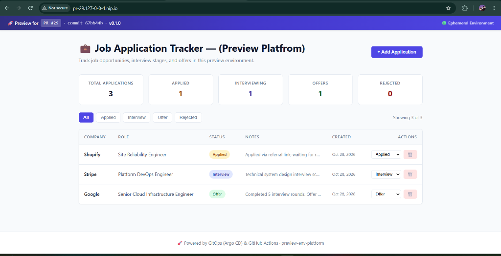
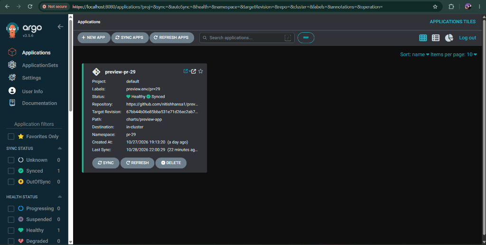
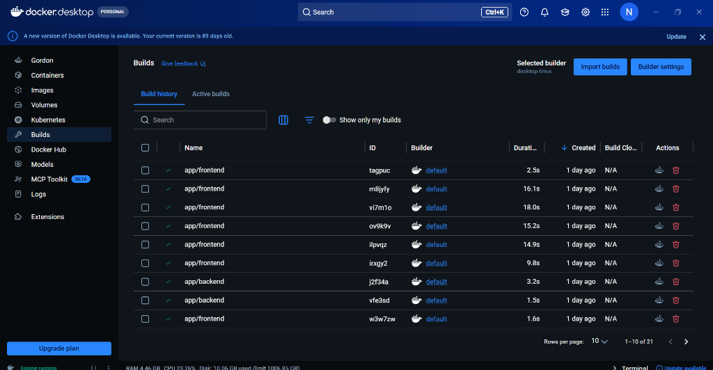
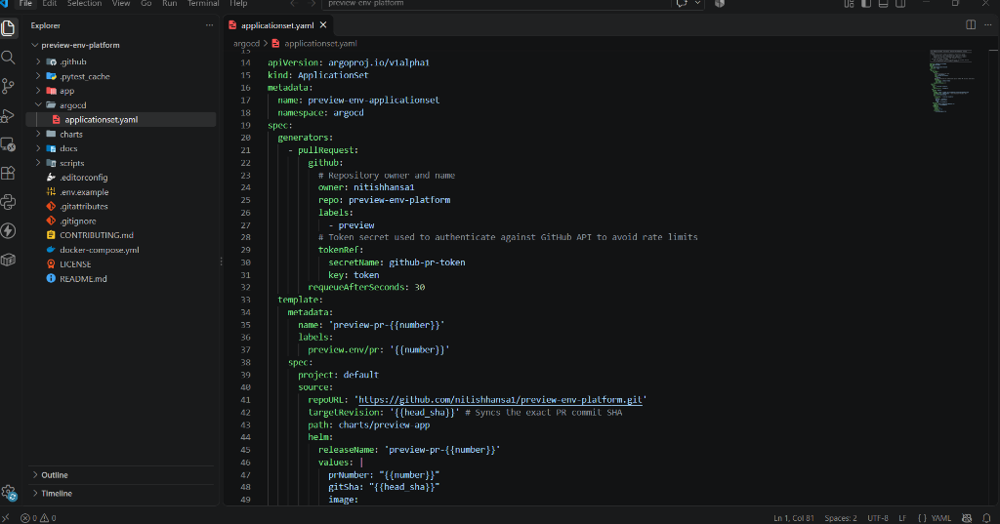

# 🚀 Preview Environment Platform (preview-env-platform)

[](LICENSE)
[](https://kubernetes.io/)
[](https://argo-cd.readthedocs.io/)
[](https://fastapi.tiangolo.com/)
[](https://react.dev/)
[](https://www.docker.com/)

> **Automated, ephemeral, per-Pull-Request preview environments on Kubernetes using GitOps (Argo CD), GitHub Actions, Helm 3, and NGINX Ingress.**

---

## 🚦 Project Status
- ✅ **Fully Operational**: Complete end-to-end GitOps pipeline running with live KinD cluster, dynamic PR generator, NGINX ingress routing, and automatic teardown.
- 📖 **Comprehensive Documentation**: Full architectural guide, operational runbook, and production incident post-mortems available in [**`docs/PROJECT_DOCUMENTATION.md`**](docs/PROJECT_DOCUMENTATION.md).

---

## 📌 Overview

**preview-env-platform** solves the classic engineering bottleneck: **"The Staging Queue"**. 

Instead of developers competing for a single shared staging environment or reviewers having to checkout branches and compile applications locally, this platform automatically spins up an isolated, production-like replica of the full application stack in its own Kubernetes namespace for every Pull Request.

### The Lifecycle in a Nutshell
1. **Developer pushes a commit / opens a PR** (e.g. PR `#29`).
2. **GitHub Actions CI** lints, runs tests, scans images for CVEs using Trivy, and pushes container images to GitHub Container Registry (GHCR).
3. **Argo CD ApplicationSet** discovers the PR, instantiates an application (`preview-pr-29`), and deploys parameterized Helm charts into namespace `pr-29`.
4. **NGINX Ingress** routes incoming traffic via wildcard DNS (`http://pr-29.127-0-0-1.nip.io`).
5. **Dedicated PostgreSQL StatefulSet** provisions an isolated persistent volume for schema migrations and test data.
6. **Closing or merging the PR** triggers cascading finalizers that completely destroy the namespace, services, pods, and volumes.

---

## 🏗️ Architecture

```
                                  +---------------------------------------+
                                  |            GitHub Repository          |
                                  |   (PR Opened / Updated / Closed)      |
                                  +---------------------------------------+
                                       |                             |
                       1. PR Trigger   |                             | 2. PR Webhook /
                                       v                             |    Polling (30s)
                    +-----------------------------+                  v
                    |    GitHub Actions CI        |       +---------------------+
                    | - Lint & Pytest / Vite test |       |   Argo CD Server    |
                    | - Trivy Security Scan       |       |  (ApplicationSet    |
                    | - Build & Push Docker Image |       |   PR Generator)     |
                    |   to GHCR (tag: pr-<num>)   |       +---------------------+
                    +-----------------------------+                  |
                                       |                             | 3. Render Helm Chart &
                                       v                             |    Sync Manifests
                    +-----------------------------+                  v
                    | GitHub Container Registry   |       +----------------------------+
                    | (GHCR: ghcr.io/nitishhansa1)|       | Kubernetes Cluster         |
                    +-----------------------------+       | (kind / k3d / k3s)         |
                                                               |
                                                               +---> [ Namespace: pr-<num> ]
                                                                      |-- NGINX Ingress (pr-<num>.127-0-0-1.nip.io)
                                                                      |-- React Frontend (Port 8080)
                                                                      |-- FastAPI Backend (Port 8000)
                                                                      |-- Dedicated Postgres 16 StatefulSet (1Gi PV)
                                                                      |-- ResourceQuota & Security Contexts
```

### Key Components
| Component | Technology | Role |
| :--- | :--- | :--- |
| **Cluster Orchestration** | Kubernetes (KinD v1.37 / K3d) | Multi-node local Kubernetes cluster runtime |
| **GitOps Controller** | Argo CD + ApplicationSet Controller | Pull Request SCM generator & automated reconciliation |
| **Packaging** | Helm 3 | Parametric multi-tier application template |
| **API Backend** | FastAPI (Python 3.11/3.12) + SQLAlchemy | RESTful Job Application Tracker with lifecycle probes |
| **Web Frontend** | React + Vite + NGINX Unprivileged | Responsive Single Page Dashboard for job applications |
| **Persistence** | PostgreSQL 16 (StatefulSet) | Dedicated per-PR persistent disk volume |
| **Ingress & DNS** | NGINX Ingress Controller + `nip.io` | Zero-cost wildcard domain routing |
| **CI / Security** | GitHub Actions + Aqua Trivy | Automated testing and container vulnerability scanning |

---

## 📸 Live Demo & Screenshots

### 1. Active Ephemeral Preview Dashboard
Reviewers open `http://pr-29.127-0-0-1.nip.io` to interact with the full app, displaying the active PR badge, commit SHA, and database records:


### 2. Argo CD GitOps Dashboard
Argo CD continuously synchronizes state from Git; application `preview-pr-29` is shown in a clean `Synced` and `Healthy` state:


### 3. Docker Buildx Pipeline
Container layers and images compiled and tracked through Docker Desktop:


### 4. GitOps PR Generator Configuration
The declarative ApplicationSet specification in VS Code:


---

## 📋 Prerequisites

Before running this project locally, ensure you have installed:
- [Docker Desktop](https://docs.docker.com/get-docker/) (v24.0+)
- [kubectl](https://kubernetes.io/docs/tasks/tools/) (v1.28+)
- [kind](https://kind.sigs.k8s.io/) (v0.20+)
- [Helm](https://helm.sh/docs/intro/install/) (v3.12+)
- [Git](https://git-scm.com/)

---

## 🛠️ Local Setup & Quickstart

### 1. Clone the Repository
```bash
git clone https://github.com/nitishhansa1/preview-env-platform.git
cd preview-env-platform
```

### 2. Create the Local Kubernetes Cluster
Run the automated bootstrap script to create a KinD cluster configured with port mappings (80/443), NGINX Ingress Controller, and Argo CD:
```bash
chmod +x scripts/setup-kind.sh
./scripts/setup-kind.sh
```

### 3. Deploy Argo CD ApplicationSet
Apply the GitOps controller ApplicationSet definition:
```bash
kubectl apply -f argocd/applicationset.yaml
```

### 4. Access Argo CD Dashboard
```bash
kubectl port-forward svc/argocd-server -n argocd 8080:443
```
- **URL**: `https://localhost:8080`
- **Username**: `admin`
- **Password**: Retrieve with:
  ```bash
  kubectl -n argocd get secret argocd-initial-admin-secret -o jsonpath="{.data.password}" | base64 -d
  ```

### 5. Access Preview Environments
Each pull request is automatically reachable at:
`http://pr-<number>.127-0-0-1.nip.io`

---

## 🔄 Making Changes & Demoing the Workflow

To push an update and see your changes reflected live in the preview environment:

```cmd
cd "D:\preview-env-platform"
git add .
git commit -m "feat(ui): update application tracker header"
git push origin test-preview
```

1. **GitHub Actions** builds and publishes the new container image to GHCR with tag `pr-29`.
2. **Argo CD** detects the new Git commit SHA within ~30–60 seconds and initiates an automated sync.
3. **Kubernetes** performs a rolling update of the pods (`imagePullPolicy: Always`).
4. Refresh `http://pr-29.127-0-0-1.nip.io` (`Ctrl + F5`) to see the updated interface live!

---

## 💡 Real-World Technical Problems & Post-Mortems

This repository includes real production-grade debugging scenarios documented in detail in [**`docs/PROJECT_DOCUMENTATION.md`**](docs/PROJECT_DOCUMENTATION.md) and [**`docs/problems-and-fixes.md`**](docs/problems-and-fixes.md):

| # | Incident / Problem | Root Cause | Solution & Fix |
|---|---------------------|------------|----------------|
| 1 | **Argo CD Sync Failure (`volumeClaimTemplates` immutable)** | `spec.volumeClaimTemplates` had dynamic commit-SHA labels that triggered immutable field patch errors on subsequent commits. | Removed mutable labels from `volumeClaimTemplates.metadata.labels`, keeping only invariant labels. |
| 2 | **HTTP 500 `relation "applications" does not exist`** | Startup race condition: FastAPI's DB retry window (10s) timed out before fresh PostgreSQL PVC finished init, skipping table creation. | Expanded retry budget in `app/main.py` to 60s (15 retries × 4s), allowing auto-migration on fresh disks. |
| 3 | **ApplicationSet Helm Values Path Mismatch** | ApplicationSet passed nested parameters (`global.prNumber`) that did not match flat top-level keys in `values.yaml`. | Aligned `argocd/applicationset.yaml` to pass flat keys matching `values.yaml`. |
| 4 | **GHCR `ImagePullBackOff` in Dynamic Namespaces** | PR namespaces lacked container registry credentials. | Set GHCR package visibility to public for preview builds or injected namespace secrets via pre-sync hooks. |
| 5 | **IPv6 Localhost Probe Failures** | Probes checking `localhost:8080` resolved to `::1` while NGINX listened on IPv4 (`127.0.0.1`). | Explicitly bound and probed `127.0.0.1` across all Dockerfiles and Kubernetes manifests. |
| 6 | **Noisy Neighbor Resource Contention** | Multiple concurrent PRs risked exhausting host CPU/RAM. | Implemented strict per-namespace `ResourceQuota` (800m CPU, 768Mi RAM, 5 pods max). |

---

## 🛡️ Security Hardening

- **Non-Root Execution**: Backend runs as UID `10001` (`appuser`); Frontend runs as UID `101` (`nginx-unprivileged`).
- **Read-Only Root Filesystems**: Both deployments enforce `readOnlyRootFilesystem: true` with writable ephemeral directories mounted via `emptyDir` at `/tmp`.
- **Minimal Capabilities**: All default Linux capabilities dropped (`capabilities.drop: [ALL]`).
- **Resource Boundaries**: Strict namespace `ResourceQuota` prevents denial-of-service or node starvation.

---

## 📄 License

This project is licensed under the MIT License - see the [LICENSE](LICENSE) file for details.
