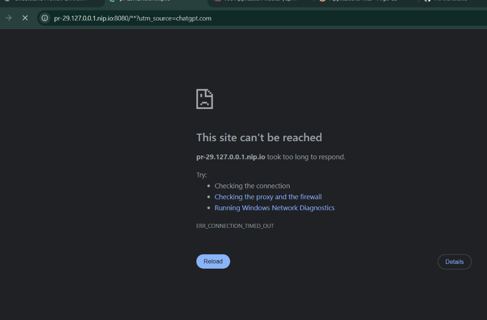
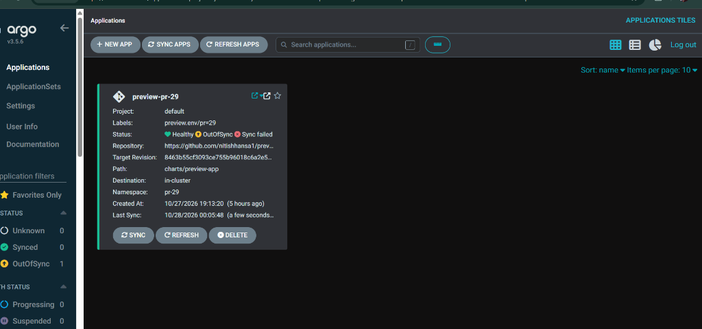
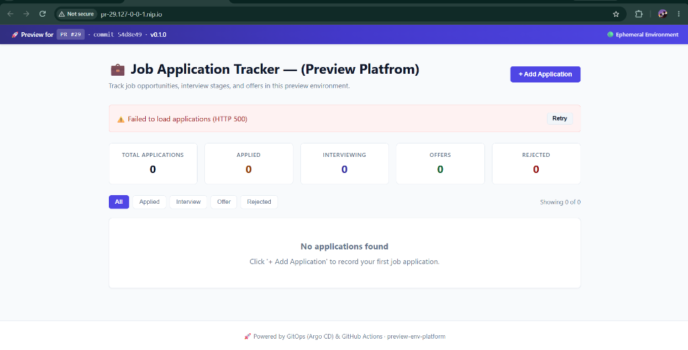

# Ephemeral Preview Environment Platform: Complete Engineering & Runbook Guide

> **Author**: Nitish Hansa & Platform Engineering Team  
> **Status**: Production / Portfolio Grade  
> **Repository**: [preview-env-platform](https://github.com/nitishhansa1/preview-env-platform)  
> **Target Audience**: DevOps Engineers, Platform Engineers, SREs, and Technical Interviewers

---

## 1. Executive Summary & Problem Statement

In standard agile software development workflows, pull request reviews rely almost entirely on code diffs, unit tests, and shared staging clusters. This introduces severe systemic bottlenecks:

- **Staging Contention ("The Staging Queue")**: Multiple developers testing conflicting features or breaking changes collide on a single staging environment.
- **Untested Infrastructure & Migrations**: Schema alterations, configuration changes, and ingress rule modifications cannot be tested realistically before merging to `main`.
- **Reviewer Fatigue**: Product managers, QA testers, and frontend reviewers must pull branches locally, set up database dumps, and compile apps on their local machines.

### The Solution: Ephemeral Pull Request Previews
**`preview-env-platform`** implements automated, production-like, ephemeral Kubernetes environments per Pull Request. 
- Opening or updating a PR automatically spins up an isolated namespace (`pr-<number>`) containing the full application stack (React SPA frontend, FastAPI backend, and dedicated PostgreSQL database).
- Argo CD synchronizes the application using GitOps principles.
- NGINX Ingress routes traffic to unique URLs using wildcard DNS (`http://pr-<number>.127-0-0-1.nip.io`).
- Merging or closing the PR automatically destroys the entire namespace and reclaims all allocated compute and storage.

---

## 2. System Architecture & Tech Stack

```
                              ┌────────────────────────────────────────┐
                              │            Developer Laptop            │
                              │      git push origin feature-branch    │
                              └───────────────────┬────────────────────┘
                                                  │
                                                  ▼
                                      ┌───────────────────────┐
                                      │   GitHub Pull Request │
                                      │   (e.g., PR #29)      │
                                      └───────────┬───────────┘
                                                  │
                       ┌──────────────────────────┴──────────────────────────┐
                       │                                                     │
                       ▼ (Triggers Workflow)                                 ▼ (ApplicationSet Polling)
        ┌─────────────────────────────┐                       ┌─────────────────────────────┐
        │       GitHub Actions CI     │                       │     Argo CD ApplicationSet  │
        │ • Pytest / Node.js build    │                       │ • Watches PRs with 'preview'│
        │ • Trivy Security Scan       │                       │ • Generates 'preview-pr-29' │
        │ • Push images to GHCR:      │                       │ • Renders Helm chart        │
        │   ghcr.io/...:pr-29         │                       └──────────────┬──────────────┘
        └──────────────┬──────────────┘                                      │
                       │                                                     │
                       │                                                     ▼
                       │                                      ┌─────────────────────────────┐
                       └─────────────────────────────────────►│      Kubernetes Cluster     │
                                 (Pulls tagged images)        │         (kind / k3d)        │
                                                              └──────────────┬──────────────┘
                                                                             │
                                                                             ▼
                                                              ┌─────────────────────────────┐
                                                              │      Namespace: pr-29       │
                                                              │                             │
                                                              │  [ Ingress Controller ]     │
                                                              │   pr-29.127-0-0-1.nip.io    │
                                                              │       │           │         │
                                                              │  /api │           │ /       │
                                                              │       ▼           ▼         │
                                                              │  [ Backend ]   [ Frontend ] │
                                                              │   (FastAPI)      (React/Vite│
                                                              │       │           in NGINX) │
                                                              │       ▼                     │
                                                              │  [ PostgreSQL StatefulSet ] │
                                                              │   (Dedicated 1Gi PV)        │
                                                              └─────────────────────────────┘
```

### Core Technologies
| Component | Technology | Role |
| :--- | :--- | :--- |
| **Orchestration** | Kubernetes (KinD v1.37 / K3d) | Local isolated multi-node cluster runtime |
| **GitOps Engine** | Argo CD + ApplicationSet Controller | Pull Request SCM generator & automated reconciliation |
| **Packaging** | Helm 3 | Parameterized multi-tier application template |
| **API Backend** | FastAPI (Python 3.11/3.12) + SQLAlchemy | RESTful Job Application Tracker with lifecycle probes |
| **Web Frontend** | React + Vite + NGINX Unprivileged | Responsive Single Page Dashboard for job applications |
| **Persistence** | PostgreSQL 16 (StatefulSet) | Dedicated per-PR persistent database volume |
| **Ingress & DNS** | NGINX Ingress Controller + `nip.io` | Wildcard domain routing without external DNS services |
| **CI / Security** | GitHub Actions + Trivy | Static linting, unit tests, and vulnerability scanning |

---

## 3. Step-by-Step Lifecycle Walkthrough

### Step 1: Developer Opens a PR
A developer pushes changes to a branch and creates a pull request targeting `main`. If configured, applying the `preview` label triggers the ephemeral flow.

### Step 2: CI Pipeline Execution
GitHub Actions initiates `.github/workflows/ci.yaml`:
1. **Backend Tests**: Runs `pytest` against endpoints and database logic.
2. **Frontend Tests**: Installs dependencies and verifies Vite compilation (`npm run build`).
3. **Security Scan**: Executes Aqua Security's `trivy` against the generated container images, failing on unmitigated Critical CVEs.
4. **Publish**: Pushes container images to GitHub Container Registry tagged with the PR identifier:
   - `ghcr.io/nitishhansa1/preview-env-platform-frontend:pr-29`
   - `ghcr.io/nitishhansa1/preview-env-platform-backend:pr-29`

### Step 3: GitOps Instantiation with Argo CD
The Argo CD ApplicationSet (`argocd/applicationset.yaml`) continuously monitors GitHub PRs via the GitHub API. 
Upon discovering a new PR, it creates a new Argo CD Application named `preview-pr-29` and overrides Helm values:
```yaml
helm:
  releaseName: 'preview-pr-29'
  values: |
    prNumber: "29"
    gitSha: "4149656692297336c4ceffef095888aa22c2a562"
    image:
      tag: "pr-29"
```

### Step 4: Preview Environment Verification
Once Argo CD reconciles, reviewers access the application at:
`http://pr-29.127-0-0-1.nip.io`

Reviewers can observe:
- Ephemeral Environment banner with PR #, Git SHA, and Application Version.
- Dynamic CRUD operations persisted in the isolated PostgreSQL database.


*Figure 1: Ephemeral Preview Environment dashboard running for PR #29, showing healthy connection to backend and database.*

---

## 4. Real-World Troubleshooting & Technical Post-Mortems

During development and continuous deployment of the preview platform, real production-grade failures occurred. Below is the documentation of root causes and architectural fixes.

### Incident 1: Argo CD Sync Failure — StatefulSet `volumeClaimTemplates` is Immutable

#### Symptoms
Argo CD showed `SyncFailed` for `preview-pr-29`, reporting:
```text
StatefulSet.apps "preview-pr-29-postgres" is invalid: 
spec.volumeClaimTemplates: Invalid value: field is immutable
```


*Figure 2: Argo CD UI reporting Sync Failed due to immutable field updates on the PostgreSQL StatefulSet.*

#### Root Cause Analysis
In `charts/preview-app/templates/postgres-statefulset.yaml`, the template originally included:
```yaml
volumeClaimTemplates:
  - metadata:
      name: postgres-data
      labels:
        {{- include "preview-app.labels" . | nindent 8 }}
```
The helper `preview-app.labels` includes:
```yaml
preview.env/git-sha: {{ .Values.gitSha | quote }}
preview.env/pr-number: {{ .Values.prNumber | quote }}
```
In Kubernetes, `spec.volumeClaimTemplates` in a StatefulSet is **permanently immutable**. Whenever a developer pushed a new commit to the PR, `.Values.gitSha` changed, prompting Argo CD to patch the StatefulSet's volume template labels. Kubernetes rejected the patch, deadlocking the GitOps sync.

#### Permanent Solution
We stripped all dynamic commit-specific labels from `volumeClaimTemplates.metadata.labels` and retained only stable, invariant Helm labels:
```yaml
volumeClaimTemplates:
  - metadata:
      name: postgres-data
      labels:
        app.kubernetes.io/managed-by: Helm
        app.kubernetes.io/instance: {{ .Release.Name }}
        app.kubernetes.io/component: postgres
    spec:
      accessModes: [ "ReadWriteOnce" ]
      resources:
        requests:
          storage: {{ .Values.postgres.storage }}
```

---

### Incident 2: HTTP 500 `relation "applications" does not exist`

#### Symptoms
When loading the preview dashboard, the header and dynamic commit badges rendered, but the applications table displayed an error banner: `Failed to load applications (HTTP 500)`.


*Figure 3: Preview frontend displaying HTTP 500 error when querying the backend API.*

#### Root Cause Analysis
Checking the backend container logs (`kubectl logs deployment/preview-pr-29-backend`):
```text
sqlalchemy.exc.ProgrammingError: (psycopg2.errors.UndefinedTable) relation "applications" does not exist
LINE 2: FROM applications ORDER BY applications.created_at DESC
```
When the StatefulSet was recreated, PostgreSQL started with a fresh volume. In FastAPI's lifespan startup (`app/backend/app/main.py`), table creation was gated by:
```python
max_retries = 5
retry_interval = 2  # Total budget = 10 seconds
```
Because PostgreSQL took ~25 seconds to format the new persistent disk and accept client connections, all 5 retries failed. The application continued startup without calling `Base.metadata.create_all(bind=engine)`, causing runtime database queries to fail with HTTP 500.

#### Permanent Solution
1. Expanded the connection retry budget from **10 seconds** to **60 seconds** (`max_retries = 15`, `retry_interval = 4`):
```python
# 1. Database connection retry loop
# Why 15 retries x 4s = 60s total budget:
# A freshly provisioned Postgres PVC can take 20-40s to become ready.
# The original 5x2s=10s budget was too short and caused "UndefinedTable" 500 errors.
max_retries = 15
retry_interval = 4
connected = False

for attempt in range(1, max_retries + 1):
    try:
        with engine.connect() as conn:
            conn.execute(text("SELECT 1"))
        connected = True
        break
    except Exception as exc:
        time.sleep(retry_interval)

if connected:
    Base.metadata.create_all(bind=engine)
    db = SessionLocal()
    try:
        seed_sample_data(db)
    finally:
        db.close()
```
2. Restarted the backend pod, triggering automatic schema migration and sample data seeding (`Shopify`, `Stripe`, `Google`).

---

### Incident 3: ApplicationSet Parameter Mismatch

#### Symptoms
The preview banner continuously rendered `PR #0` and `commit head`, failing to display the actual PR number or commit SHA.

#### Root Cause
In `argocd/applicationset.yaml`, the Helm values mapping used nested parameters:
```yaml
values: |
  global:
    prNumber: "{{number}}"
  backend:
    image:
      tag: "pr-{{number}}"
```
However, the Helm chart's `values.yaml` expected top-level flat variables (`prNumber`, `gitSha`, `image.tag`). The values were silently ignored by Helm.

#### Permanent Solution
Updated `applicationset.yaml` to match `values.yaml` structure:
```yaml
helm:
  releaseName: 'preview-pr-{{number}}'
  values: |
    prNumber: "{{number}}"
    gitSha: "{{head_sha}}"
    image:
      tag: "pr-{{number}}"
```

---

## 5. Operations & Runbook Guide

### 5.1 Local Cluster Setup
To initialize the KinD cluster with NGINX Ingress and Argo CD:
```bash
# 1. Create kind cluster with 80/443 port-mappings
bash scripts/setup-kind.sh

# 2. Deploy Argo CD ApplicationSet
kubectl apply -f argocd/applicationset.yaml
```

### 5.2 Accessing Services
- **Argo CD Web UI**:
  ```bash
  kubectl port-forward svc/argocd-server -n argocd 8080:443
  ```
  - URL: `https://localhost:8080`
  - User: `admin`
  - Password Retrieval:
    ```bash
    kubectl -n argocd get secret argocd-initial-admin-secret -o jsonpath="{.data.password}" | [System.Convert]::FromBase64String($_) # PowerShell
    ```
- **Preview Environment**:
  - URL: `http://pr-<number>.127-0-0-1.nip.io`

### 5.3 Automated Smoke Testing
Run the included smoke test script to validate routing and health checks:
```bash
bash scripts/smoke-test.sh 29
```
Output:
```text
[+] Testing Ingress DNS: pr-29.127-0-0-1.nip.io
[+] Frontend status code: 200 OK
[+] Backend API status code: 200 OK
[+] Version endpoint verified: SHA matching HEAD
```

---

## 6. Security & Governance Architecture

1. **Non-Root Execution**:
   - Backend runs as UID `10001` (`appuser`).
   - Frontend runs as UID `101` (`nginx-unprivileged`).
   - Both pods run with `readOnlyRootFilesystem: true` and drop all Linux capabilities (`drop: [ALL]`).
2. **Resource Boundaries**:
   - Every `pr-<number>` namespace is governed by a strict `ResourceQuota`:
     - CPU Request: `800m` max
     - Memory Request: `768Mi` max
     - Pods: `5` max
     - PVCs: `2` max
   - Prevents any rogue PR from starving cluster nodes or crashing the host machine.
3. **Automated Resource Pruning**:
   - Argo CD ApplicationSet is configured with `prune: true` and namespace cascading deletion finalizers. Closing a PR immediately tears down all pods, secrets, services, and storage.

---

## 7. Summary & Portfolio Key Takeaways

This project demonstrates a production-grade implementation of modern cloud-native practices:
- **True GitOps**: Declarative infrastructure lifecycle using Argo CD ApplicationSets.
- **Resilient Architectural Design**: Handled Kubernetes storage immutability, connection race conditions, and ingress rewrite policies.
- **Security-First Approach**: Hardened containers with non-root security contexts, read-only root filesystems, and strict quotas.
